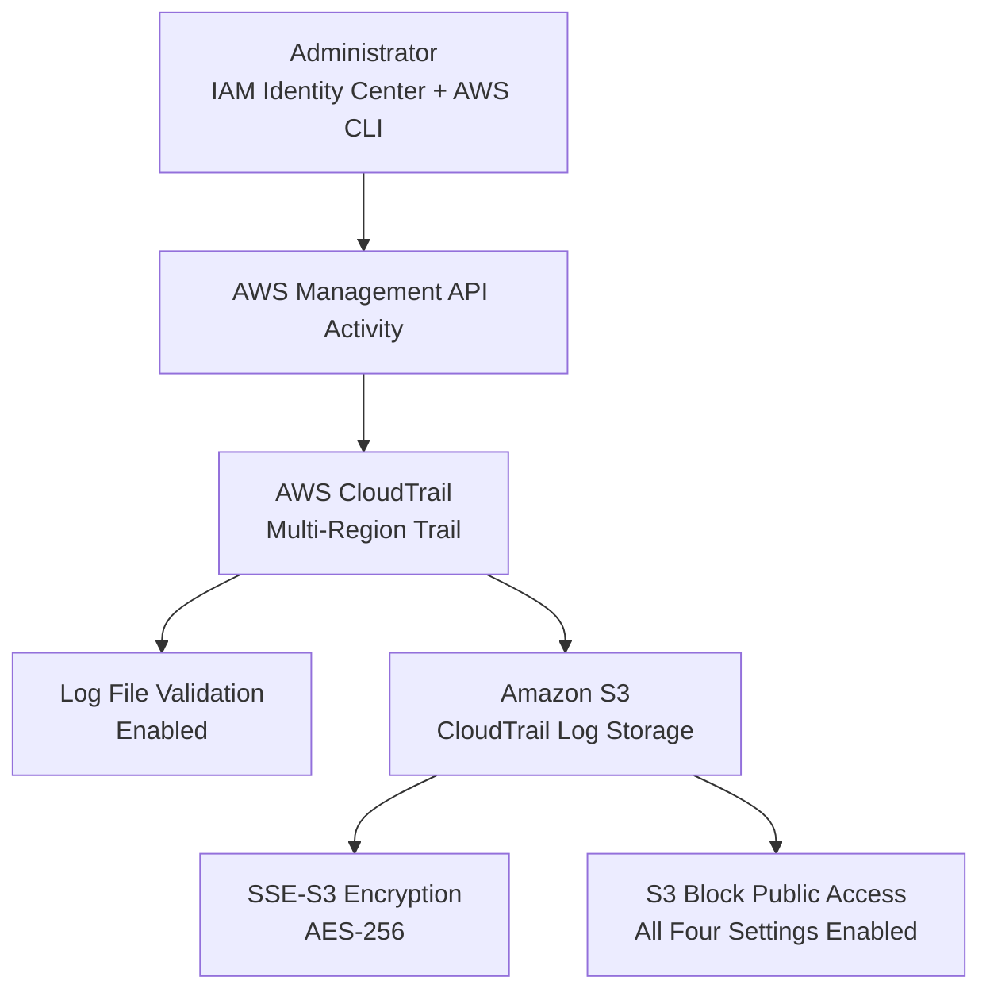

# AWS Security Architecture

## Architecture Notes

CloudTrail records supported AWS management events and delivers logs to an Amazon S3 bucket. Log-file validation is enabled to help verify the integrity of delivered log files. The destination bucket uses SSE-S3 encryption and has all four bucket-level S3 Block Public Access settings enabled.

S3 data events are not enabled in this lab configuration.
